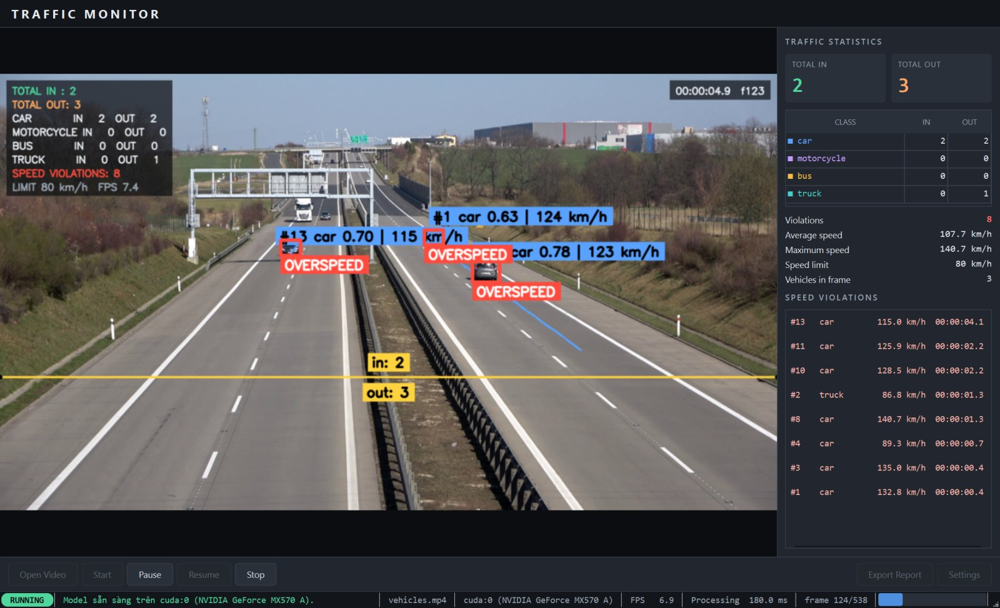
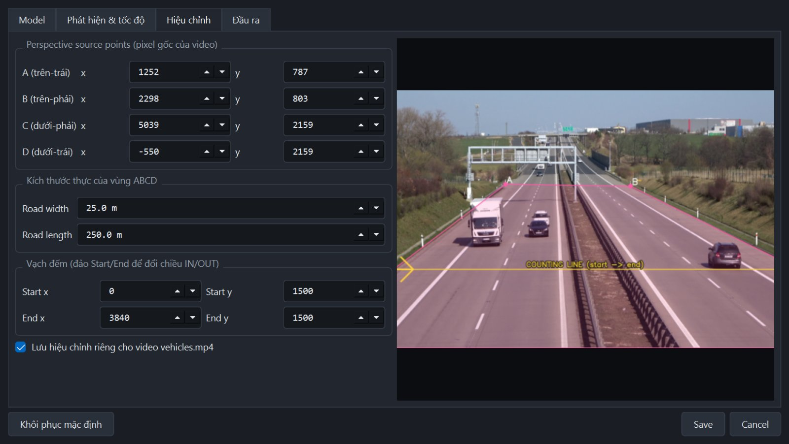
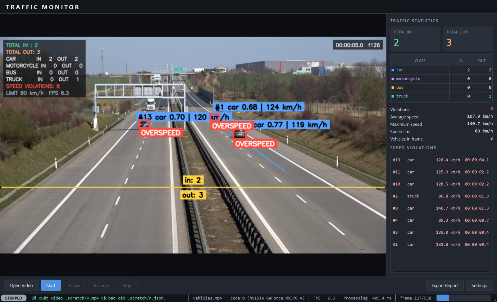
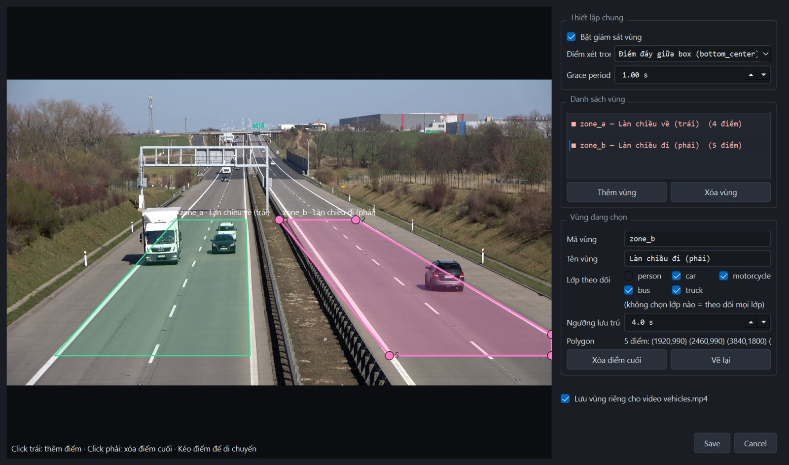
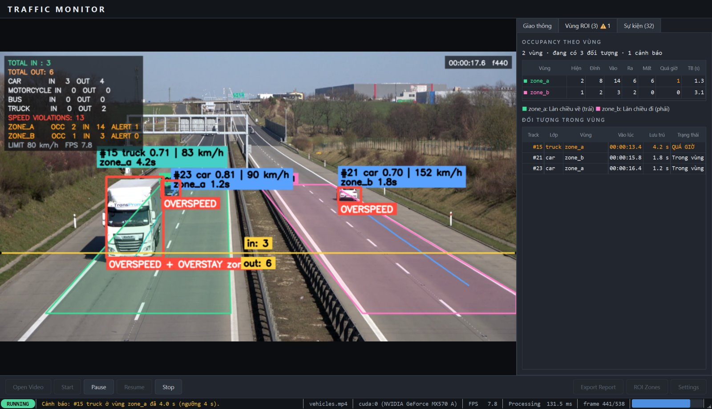

# 🚦 Traffic Monitor: giám sát giao thông thông minh với YOLOv8


-41CD52?logo=qt&logoColor=white)


**Traffic Monitor** là ứng dụng desktop phân tích video giao thông trên GPU. Ứng dụng phát hiện và phân loại phương tiện bằng **YOLOv8n**, theo vết từng xe bằng **ByteTrack**, đếm lượt xe **IN/OUT** qua vạch đếm, **ước lượng tốc độ (km/h)** bằng biến đổi phối cảnh, **phát hiện xe vượt tốc độ**, **giám sát đối tượng trong vùng ROI** (số đối tượng hiện có, thời gian lưu trú, sự kiện vào/ra, cảnh báo quá giờ), hiển thị thống kê theo thời gian thực, và xuất **video đã chú thích** cùng **báo cáo JSON/CSV**.

Đây là sản phẩm cuối (Bài 9) của giáo trình [Supervision](https://github.com/roboflow/supervision), được triển khai theo kiến trúc phân tầng Core / Pipeline / Services / UI.



---

## Mục lục

1. [Mô tả dự án](#1-mô-tả-dự-án)
2. [Công nghệ sử dụng](#2-công-nghệ-sử-dụng)
3. [Tính năng](#3-tính-năng)
4. [Kiến trúc hệ thống](#4-kiến-trúc-hệ-thống)
5. [Cài đặt và chạy](#5-cài-đặt-và-chạy)
6. [Hướng dẫn sử dụng](#6-hướng-dẫn-sử-dụng)
7. [Nghiệp vụ hệ thống](#7-nghiệp-vụ-hệ-thống)
8. [Thuật toán và quy tắc tính toán](#8-thuật-toán-và-quy-tắc-tính-toán)
9. [Cấu hình](#9-cấu-hình)
10. [Đầu ra](#10-đầu-ra)
11. [Kiểm thử](#11-kiểm-thử)
12. [Hiệu năng và ghi chú kỹ thuật](#12-hiệu-năng-và-ghi-chú-kỹ-thuật)

---

## 1. Mô tả dự án

### Bài toán

Camera giao thông ghi lại lượng video lớn, nhưng đếm xe và kiểm tra tốc độ thủ công thì tốn công và dễ sai. Dự án tự động hóa việc này từ một file video:

| Câu hỏi | Hệ thống trả lời bằng |
|---|---|
| Có bao nhiêu xe đi qua, theo mỗi chiều? | Đếm IN/OUT qua vạch đếm (LineZone) |
| Mỗi chiều có bao nhiêu xe con, xe máy, xe buýt, xe tải? | Đếm IN/OUT theo từng loại xe |
| Mỗi xe chạy nhanh bao nhiêu? | Tốc độ km/h tính từ tọa độ thực (mét) sau biến đổi phối cảnh |
| Xe nào vượt tốc độ cho phép? | Danh sách vi phạm: ID xe, loại xe, tốc độ tối đa, thời điểm |
| Vùng A hiện có bao nhiêu đối tượng, ID nào? | Occupancy theo vùng và bảng đối tượng trong vùng |
| Mỗi đối tượng đã ở trong vùng bao lâu, vào/ra lúc nào? | Session gồm `entry_time`, `exit_time`, `dwell_seconds`; sự kiện ENTER / EXIT / LOST |
| Đối tượng nào ở quá thời gian cho phép? | Cảnh báo OVERSTAY theo ngưỡng `max_dwell_seconds` của từng vùng |
| Làm sao lưu lại bằng chứng và số liệu? | Video MP4 có chú thích, báo cáo JSON, file CSV session và sự kiện |

### Đối tượng sử dụng

Sinh viên và kỹ sư Computer Vision học pipeline phát hiện → theo vết → phân tích, cũng như những ai cần công cụ desktop nhẹ để phân tích nhanh video giao thông mà không phải viết code.

### Phạm vi

- **Có:** xử lý file video (MP4/AVI/MOV/MKV), 4 loại xe COCO và người (`person`), nhiều vùng ROI dạng polygon, hiệu chỉnh phối cảnh riêng cho từng video, chạy trên GPU (CUDA) và tự chuyển sang CPU khi không có GPU.
- **Chưa có:** camera trực tiếp (RTSP), nhận dạng biển số, lưu vào cơ sở dữ liệu.

---

## 2. Công nghệ sử dụng

| Nhóm | Công nghệ | Phiên bản đã kiểm thử | Vai trò trong dự án |
|---|---|---|---|
| Ngôn ngữ | **Python** | 3.10 | Toàn bộ ứng dụng; dùng type hints, dataclasses, `X \| None` |
| Phát hiện đối tượng | **Ultralytics YOLOv8n** (`yolov8n.pt`) | ultralytics 8.3.246 | Phát hiện xe (car, motorcycle, bus, truck) trên từng frame |
| Deep learning / GPU | **PyTorch + CUDA** | torch 2.5.1 + CUDA 12.1 | Chạy YOLO trên GPU NVIDIA với FP16 (half precision) |
| Computer Vision | **Supervision** (Roboflow) | 0.30.2 | `sv.Detections`, `ByteTrack`, `DetectionsSmoother`, `LineZone`, anchor điểm của box, các annotator |
| Xử lý ảnh / video | **OpenCV** | 4.12 | Đọc/ghi video, `getPerspectiveTransform`, `pointPolygonTest` (điểm trong vùng ROI), vẽ chú thích |
| Tính toán | **NumPy** | 2.2 | Ma trận tọa độ, lọc detections |
| Giao diện desktop | **PySide6 (Qt 6)** | 6.11 | Cửa sổ, widget, `QThread`, signal/slot, stylesheet tối |
| Đa luồng | `QThread` + `threading` + `queue` | – | Tách UI, inference, đọc video và ghi video ra các luồng riêng |
| Dữ liệu | `json`, `csv`, `dataclasses` | stdlib | Cấu hình, hiệu chỉnh, báo cáo JSON, CSV session/sự kiện, model dữ liệu |
| Logging | `logging` (RotatingFileHandler) | stdlib | `outputs/logs/app.log` |
| Kiểm thử | **pytest** | 9.1 | 102 test: unit, GPU, pipeline, luồng UI end-to-end |

**Thuật toán chính:** YOLOv8 (one-stage detector), ByteTrack (multi-object tracking bằng Kalman filter kết hợp ghép cặp IoU), homography 4 điểm (perspective transform), ước lượng vận tốc trên cửa sổ thời gian trượt, kiểm tra điểm trong polygon, máy trạng thái session có grace period để tính thời gian lưu trú.

---

## 3. Tính năng

- 🎯 **Phát hiện và phân loại xe** bằng YOLOv8n trên GPU, lọc theo ngưỡng confidence (mặc định 0.30) và theo loại xe được chọn.
- 🔗 **Theo vết đa đối tượng** bằng ByteTrack: mỗi xe giữ một `tracker_id` ổn định, box được làm mượt để giảm rung.
- ➕ **Đếm IN/OUT** tổng và theo 4 loại xe qua `sv.LineZone` (anchor `BOTTOM_CENTER`).
- 📏 **Ước lượng tốc độ km/h** bằng biến đổi phối cảnh từ pixel sang mét, lưu lịch sử vị trí trong `deque`.
- 🚨 **Phát hiện vượt tốc độ**: box đỏ, nhãn `OVERSPEED`, danh sách vi phạm ghi tốc độ tối đa của từng xe.
- 🖼️ **Chú thích trên frame**: bounding box, loại xe, confidence, ID, vết di chuyển, tốc độ, vạch đếm, số IN/OUT, bảng thống kê trong frame.
- 📊 **Dashboard realtime**: Total IN/OUT, IN/OUT theo loại, số vi phạm, tốc độ trung bình và tối đa, số xe trong frame.
- ⏯️ **Điều khiển**: Open Video, Start, Pause, Resume, Stop, Export Report, Settings (có phím tắt).
- ⚙️ **Settings trên UI**: model, GPU/CPU, FP16, confidence, IoU, loại xe, giới hạn tốc độ, 4 điểm phối cảnh, kích thước đường, vạch đếm, đường dẫn đầu ra. Có ảnh xem trước cập nhật ngay khi chỉnh.
- 💾 **Tự động xuất** video MP4 đã chú thích và báo cáo JSON khi Stop hoặc khi hết video.
- 🟩 **Giám sát vùng ROI** (tài liệu `docs/docs-engineer/Tai_lieu_ky_thuat_Giam_sat_doi_tuong_trong_vung.md`):
  - Vẽ nhiều vùng polygon bằng chuột trên frame (thêm điểm, kéo điểm, xóa điểm), đặt tên, chọn lớp theo dõi và ngưỡng lưu trú cho từng vùng.
  - **Occupancy**: số đối tượng đang ở trong vùng (hiện tại, đỉnh, trung bình), tách riêng với **số lượt vào** tích lũy.
  - **Dwell time**: mỗi lần vào vùng là một session có `entry_time`, thời gian lưu trú cập nhật liên tục, `exit_time` và thời gian lưu trú cuối cùng.
  - **Sự kiện** ENTER / EXIT / LOST / OVERSTAY trong tab nhật ký có bộ lọc; cảnh báo quá giờ hiện trên thanh trạng thái, trên frame (box cam, nhãn `OVERSTAY`) và trong bảng đối tượng.
  - Xuất `regions` trong báo cáo JSON và 2 file CSV: `traffic_report_sessions.csv`, `traffic_report_events.csv`.
- 🛡️ **Xử lý lỗi thân thiện**: video không tồn tại hoặc hỏng, thiếu model, lỗi codec, cấu hình sai… đều hiện thông báo tiếng Việt, không để lộ traceback cho người dùng.
- 🔒 **Máy trạng thái**: chặn thao tác sai (Start khi chưa chọn video, Pause khi chưa chạy, Export khi chưa có kết quả…) và giải thích lý do.

| Hiệu chỉnh phối cảnh và vạch đếm | Kết thúc phiên (STOPPED) |
|---|---|
|  |  |
| **Trình chỉnh vùng ROI** | **Tab Vùng ROI: occupancy và thời gian lưu trú** |
|  |  |

---

## 4. Kiến trúc hệ thống

```text
┌──────────────────────── UI (PySide6) ──────────────────────────┐
│ MainWindow · VideoWidget · DashboardWidget · ControlPanel      │
│ SettingsDialog · ROIEditorDialog · RegionPanel · ObjectTable   │
│ EventLogWidget · VideoWorker (QThread) · ModelWarmupWorker     │
└──────────────┬─────────────────────────────────────────────────┘
               │ signals/slots (frame_ready, stats_ready, ...)
┌──────────────▼──────────── Pipeline ───────────────────────────┐
│ VideoProcessor: đọc ─▶ xử lý ─▶ ghi (2 luồng I/O, queue có giới hạn) │
│ FrameProcessor: TrafficMonitor + annotators                    │
└──────────────┬─────────────────────────────────────────────────┘
┌──────────────▼──────────── Core ───────────────────────────────┐
│ TrafficMonitor (chỉ điều phối)                                 │
│  ├─ VehicleDetector        YOLOv8n → sv.Detections → lọc       │
│  ├─ VehicleTracker         ByteTrack + DetectionsSmoother      │
│  ├─ VehicleCounter         LineZone IN/OUT theo loại xe        │
│  ├─ SpeedEstimator         homography + deque → km/h           │
│  ├─ SpeedViolationDetector speed > limit                       │
│  ├─ ROIManager             anchor trong polygon + lớp cho phép │
│  ├─ DwellTimeTracker       session, ENTER/EXIT/LOST/OVERSTAY    │
│  └─ OccupancyCounter       số đối tượng trong vùng hiện tại    │
└────────────────────────────────────────────────────────────────┘
 Services: ReportService · VideoService · ConfigService · EventService
 Nền dùng chung: models (dataclass, AppState) · config · constants · utils
```

**Pipeline cho mỗi frame:** Frame → Detection → Filtering → Tracking → Counting → Speed Estimation → Violation Detection → ROI Membership → Dwell Time → Occupancy → Events → Annotation → Statistics → Processed Frame

**Luồng thread:**

```text
Main UI Thread ──start/pause/resume/stop──▶ VideoWorker (QThread)
      ▲                                        ├─ reader thread : cv2.VideoCapture → queue
      │  frame_ready(QImage)                   ├─ YOLO (GPU) → ByteTrack → LineZone → Speed → Annotate
      └──stats_ready / run_finished / error ───┴─ writer thread : queue → cv2.VideoWriter
```

### Cấu trúc thư mục

```text
traffic_monitor/
├── main.py                     # điểm khởi chạy: python main.py
├── requirements.txt
├── app/
│   ├── config/                 # settings.py (schema), default_config.json
│   ├── core/                   # detector, tracker, counter, speed_estimator, violation_detector,
│   │                           # roi_manager, dwell_time_tracker, occupancy_counter, traffic_monitor, exceptions
│   ├── models/                 # detection_result, traffic_statistics, violation, app_state,
│   │                           # roi, track_session, event, region_statistics
│   ├── pipeline/               # frame_processor, video_processor
│   ├── services/               # report_service, video_service, config_service, event_service
│   ├── ui/                     # main_window, video_widget, dashboard_widget, control_panel, settings_dialog,
│   │                           # roi_editor, region_panel, object_table, event_log_widget, video_worker, styles
│   ├── utils/                  # display, logger, file_utils, time_utils, geometry, device, qt_compat
│   └── constants/              # classes (COCO ids, màu), messages (thông báo tiếng Việt)
├── models/                     # yolov8n.pt (không commit, xem phần cài đặt)
├── data/
│   ├── input/                  # video đầu vào (không commit)
│   └── calibration/            # hiệu chỉnh theo video, ví dụ vehicles.json
├── outputs/                    # videos/, reports/, logs/
├── docs/                       # traffic_monitor_spec.html (tài liệu thiết kế), images/
└── tests/                      # 176 test pytest
```

Hướng phụ thuộc chỉ đi một chiều: `ui → pipeline/services → core → models/constants/utils`. Tầng `core` và `pipeline` không import PySide6, nên kiểm thử được mà không cần giao diện.

📄 Tài liệu:
- Yêu cầu ban đầu: [`docs/traffic_monitor_requirements.md`](docs/traffic_monitor_requirements.md)
- Tài liệu thiết kế chi tiết (SDD, có demo UI tương tác): [`docs/traffic_monitor_spec.html`](docs/traffic_monitor_spec.html)
- Tài liệu kỹ thuật giám sát đối tượng trong vùng ROI: [`docs/region_monitoring_spec.md`](docs/region_monitoring_spec.md)

---

## 5. Cài đặt và chạy

### Yêu cầu

- Python **3.10+**
- GPU NVIDIA có CUDA (khuyến nghị). Đã kiểm thử trên GeForce MX570 2 GB. Máy không có GPU vẫn chạy được bằng CPU.
- Windows, Linux hoặc macOS

### Các bước

```bash
git clone https://github.com/Tuyetmai0705/Traffic-Monitor-YoloV8.git
cd Traffic-Monitor-YoloV8

# 1. PyTorch bản CUDA (chọn đúng bản CUDA của máy tại https://pytorch.org)
pip install torch torchvision --index-url https://download.pytorch.org/whl/cu121

# 2. Các thư viện còn lại
pip install -r requirements.txt

# 3. Trọng số YOLOv8n → models/yolov8n.pt
python -c "from ultralytics import YOLO; YOLO('models/yolov8n.pt')"

# 4. Video mẫu → data/input/vehicles.mp4 (đã có sẵn hiệu chỉnh trong data/calibration/)
cd data/input && python -c "from supervision.assets import download_assets, VideoAssets; download_assets(VideoAssets.VEHICLES)" && cd ../..

# 5. Chạy ứng dụng
python main.py
```

Kiểm tra GPU: `python -c "import torch; print(torch.cuda.is_available(), torch.cuda.get_device_name(0))"`

---

## 6. Hướng dẫn sử dụng

1. **Open Video** (Ctrl+O): chọn file trong `data/input/`. Khung video hiện frame đầu kèm vạch đếm (vàng) và vùng phối cảnh ABCD (hồng).
2. **Settings** (Ctrl+,): chỉnh model, thiết bị, confidence, giới hạn tốc độ, loại xe. Với video mới, vào tab **Hiệu chỉnh** để đặt 4 điểm A–D bao một đoạn đường có kích thước thực đã biết, rồi đặt vạch đếm.
3. **Start** (F5): bắt đầu xử lý trên GPU. Video chú thích và dashboard cập nhật liên tục.
4. **Pause** (F6) / **Resume** (F7): tạm dừng hoặc tiếp tục.
5. **Stop** (F8): dừng. Video và báo cáo được xuất tự động vào `outputs/`.
6. **Export Report** (Ctrl+E): lưu báo cáo JSON (kèm 2 file CSV vùng ROI) ra vị trí khác.
7. **ROI Zones** (Ctrl+R): vẽ và chỉnh vùng giám sát. Click trái để thêm điểm, kéo điểm để di chuyển, click phải để xóa điểm cuối. Đặt mã vùng (ASCII), tên, lớp theo dõi, ngưỡng lưu trú (0 = tắt cảnh báo), grace period và điểm xét trong vùng; tích "Lưu vùng riêng cho video" để gắn vùng với video đang mở.

| Vùng giao diện | Nội dung |
|---|---|
| Video | Frame đã chú thích: box, loại xe, confidence, `#ID`, vết di chuyển, km/h, `OVERSPEED`, vạch đếm, IN/OUT, bảng thống kê trong frame |
| Tab Giao thông | TOTAL IN/OUT, bảng IN/OUT theo loại, Violations, Average/Maximum speed, Speed limit, số đối tượng trong frame, danh sách vi phạm |
| Tab Vùng ROI | Theo từng vùng: hiện tại, đỉnh, lượt vào, ra, mất dấu, quá giờ, thời gian lưu trú trung bình. Bảng đối tượng trong vùng: track, lớp, vùng, vào lúc, thời gian lưu trú, trạng thái |
| Tab Sự kiện | Nhật ký ENTER / EXIT / LOST / OVERSTAY mới nhất ở trên, có bộ lọc theo loại và bộ đếm |
| Thanh trạng thái | Trạng thái (màu), thông báo, file, GPU, FPS, thời gian xử lý mỗi frame, frame hiện tại/tổng, thanh tiến độ |

---

## 7. Nghiệp vụ hệ thống

### 7.1 Máy trạng thái

```text
IDLE ──open──▶ VIDEO_SELECTED ──start──▶ RUNNING ◀──resume── PAUSED
  │                  ▲                   │  │  └────pause─────▶  │
  └─mở lỗi─▶ ERROR   │                   │  └────stop──▶ STOPPED ◀─stop─┘
             │       │                   └──hết video──▶ COMPLETED
             └───────┴──── open (từ STOPPED / COMPLETED / ERROR)
```

| Trạng thái | Open | Start | Pause | Resume | Stop | Export | Settings |
|---|:-:|:-:|:-:|:-:|:-:|:-:|:-:|
| IDLE | ✔ | ✘ | ✘ | ✘ | ✘ | ✘ | ✔ |
| VIDEO_SELECTED | ✔ | ✔ | ✘ | ✘ | ✘ | ✘ | ✔ |
| RUNNING | ✘ | ✘ | ✔ | ✘ | ✔ | ✘ | ✘ |
| PAUSED | ✘ | ✘ | ✘ | ✔ | ✔ | ✘ | ✘ |
| STOPPED | ✔ | ✔ (chạy lại) | ✘ | ✘ | ✘ | ✔ | ✔ |
| COMPLETED | ✔ | ✔ (chạy lại) | ✘ | ✘ | ✘ | ✔ | ✔ |
| ERROR | ✔ | ✘ | ✘ | ✘ | ✘ | ✘ | ✔ |

Nút **ROI Zones** có cùng quyền với Settings: chỉ dùng được khi không đang chạy hoặc tạm dừng.

Nút bị chặn hiển thị mờ nhưng vẫn bấm được; khi bấm, thanh trạng thái giải thích lý do. Luật nằm ở `app/models/app_state.py`.

### 7.2 Các luồng nghiệp vụ

| # | Luồng | Điều kiện | Các bước | Kết quả | Ngoại lệ |
|---|---|---|---|---|---|
| NV1 | Khởi động | – | Ghi log → đọc config → tạo `outputs/` → hiện cửa sổ → tải YOLOv8n lên GPU ở luồng nền | IDLE, "Model sẵn sàng trên cuda:0" | Không có GPU: chạy CPU và cảnh báo |
| NV2 | Mở video | Không đang chạy | Chọn file → kiểm tra file, codec, frame đầu → nạp hiệu chỉnh riêng → xem trước | VIDEO_SELECTED | File không tồn tại hoặc hỏng: ERROR. Chưa có hiệu chỉnh: đặt vạch mặc định và nhắc người dùng |
| NV3 | Cấu hình | Không đang chạy | Settings → chỉnh → Save | Lưu `user_config.json` và hiệu chỉnh theo video | Giá trị sai: tô đỏ ô sai, không lưu |
| NV4 | Xử lý | Đã chọn video | Start → worker QThread chạy toàn bộ pipeline trên GPU | RUNNING, UI vẫn phản hồi | Thiếu model hoặc lỗi inference: ERROR, vẫn lưu phần kết quả đã xử lý |
| NV5 | Tạm dừng / tiếp tục | RUNNING / PAUSED | Pause / Resume | PAUSED ↔ RUNNING | – |
| NV6 | Dừng | RUNNING / PAUSED | Stop → đóng video → xuất báo cáo | STOPPED | – |
| NV7 | Hoàn tất | Hết video | Tự động xuất video và báo cáo | COMPLETED | – |
| NV8 | Xuất báo cáo | STOPPED / COMPLETED | Export Report → chọn nơi lưu | File JSON mới | Không ghi được: báo lỗi |
| NV9 | Chạy lại | STOPPED / COMPLETED | Start → reset thống kê → chạy lại từ đầu | RUNNING | – |
| NV10 | Đóng ứng dụng | Bất kỳ | Dừng worker, chờ thread kết thúc | Thoát sạch, file video hợp lệ | – |
| NV11 | Cấu hình vùng ROI | Không đang chạy | ROI Zones → vẽ polygon trên frame → đặt tên, lớp, ngưỡng → Save | Lưu `data/calibration/<video>.json` (hoặc `user_config.json`), xem trước cập nhật | Polygon dưới 3 điểm, cạnh cắt nhau, mã trùng: chọn vùng lỗi, báo lý do, không lưu. Chưa mở video: không vẽ được |
| NV12 | Giám sát vùng khi chạy | RUNNING | Mỗi frame: anchor trong vùng → session → occupancy → sự kiện | Tab Vùng ROI và Sự kiện cập nhật, nhãn `zone_a 3.2s` trên xe | Vùng nằm ngoài khung hình video mới: tự tắt vùng đó và cảnh báo |
| NV13 | Cảnh báo quá giờ | Session đang mở | Thời gian lưu trú vượt `max_dwell_seconds` | 1 sự kiện OVERSTAY mỗi session, cảnh báo trên thanh trạng thái, box cam | – |
| NV14 | Xuất kết quả vùng | STOPPED / COMPLETED | Tự động khi Stop / hết video, hoặc Export Report | `regions` trong JSON, `*_sessions.csv`, `*_events.csv` (UTF-8 BOM, mở trực tiếp bằng Excel) | – |

---

## 8. Thuật toán và quy tắc tính toán

| Bước | Quy tắc |
|---|---|
| Lọc | Giữ `confidence ≥ threshold` (mặc định 0.30) và `class_id ∈ {2 car, 3 motorcycle, 5 bus, 7 truck}` |
| Phát hiện | NMS bỏ qua lớp (`agnostic_nms`): một xe vừa được nhận là `car` vừa là `truck` chỉ giữ 1 box. Trên video mẫu, số cặp box trùng giảm từ 33 xuống 3 trong 60 frame đầu |
| Theo vết | `ByteTrack(frame_rate = fps thực)` → **bỏ phiếu lớp** theo track (có trọng số confidence, 30 frame) → **bộ lọc Kalman** vận tốc đều trên tâm + kích thước box. Track chỉ hiện khi đã thấy ≥ `min_hits` (3) frame, nên box nhiễu một frame không bao giờ được đếm. YOLO bỏ sót ≤ `coast_frames` (8) frame thì box vẫn hiện ở vị trí dự đoán (không dùng để đo tốc độ). Box trùng của cùng một xe (IoU > 0,6) được gộp; ByteTrack cấp ID mới ngay chỗ một xe vừa mất dấu (≤ `stitch_frames`) thì giữ ID cũ |
| Đếm | `LineZone.trigger()` được gọi **đúng 1 lần/frame**, anchor `BOTTOM_CENTER`. Đếm theo loại lấy từ mask `crossed_in` / `crossed_out`. Với vạch đi từ trái sang phải: xe đi lên là IN, xe đi xuống là OUT |
| Phối cảnh | `cv2.getPerspectiveTransform(ABCD_pixel → [0,0],[W,0],[W,L],[0,L] mét)` |
| Tốc độ | Điểm mặt đất = đáy giữa **box gốc của YOLO** (không dùng box Kalman, vì bộ lọc khởi động ở vận tốc 0 sẽ vọt lố). Vận tốc = **hệ số hồi quy tuyến tính** vị trí (mét) theo thời gian trên `deque(maxlen = fps × window_seconds)`. Chỉ đo khi điểm nằm **trong vùng hiệu chỉnh ABCD** và box không chạm mép khung hình |
| Độ tin cậy tốc độ | Một lần đo chỉ được chấp nhận khi: mỗi pixel ứng với ≤ `max_metres_per_pixel` (0,8 m) mặt đường (ở đầu xa vùng hiệu chỉnh 1 px ≈ 2 m nên không đo), xe đi ≥ `min_pixel_travel` (20 px) trên ảnh trong cửa sổ, và tốc độ của nửa đầu, nửa sau, cả cửa sổ lệch nhau ≤ 25 %. Hồi quy tự loại các điểm lệch > max(0,5 m, 3σ) rồi khớp lại. Box đổi kích thước đột ngột > 25 % (bắt đầu/hết bị che) thì xóa lịch sử đo của xe đó và đo lại. Không đạt thì **không báo số mới** (giữ số đáng tin gần nhất). Loại giá trị > `max_kmh`; số hiển thị làm mượt EMA (`smoothing_alpha`) |
| Vi phạm | `speed > limit` trong ≥ `violation_confirm_samples` (5) lần đo mới liên tiếp, nên một giá trị nhiễu đơn lẻ không thành vi phạm. Mỗi xe có 1 bản ghi, cập nhật `max_speed_kmh` |
| Tốc độ trung bình | Trung bình của tốc độ gần nhất của từng xe trong phiên |
| Trong vùng ROI | Anchor (**tâm box `center`** mặc định, hoặc `bottom_center`) nằm **trong hoặc trên biên** polygon **và** lớp được vùng cho phép. Các vùng độc lập: một đối tượng có thể thuộc nhiều vùng chồng lấn |
| Vẽ vùng khi xét theo tâm box | Xe cao (xe tải, xe buýt) có tâm box cao hơn mặt đường 1,5–2 m, nên khi chiếu xuống mặt đường tâm bị lệch về phía xa camera theo chiều ngang (video mẫu: lệch khoảng 1,5–2 m ra lề). Vì vậy cạnh vùng ở phía đó nên chừa thêm khoảng 2 m. Cạnh nơi xe rời khung hình phải đặt đủ xa mép ảnh, để tâm box ra khỏi vùng trước khi xe bị cắt ở mép (nếu không sẽ thành LOST thay vì EXIT). `zone_a` của video mẫu được vẽ theo vạch sơn đo được: lề khẩn cấp (vạch mép đường lùi ra 2 m) đến vạch giáp dải phân cách, từ hàng 990 đến 1650 (4K) |
| Thời gian | Thời gian media = `frame_index ÷ fps`, nên đồng hồ dừng khi Pause |
| Vào vùng | Track ở trong vùng **liên tiếp `min_confirm_frames` (3) frame** mới mở session và phát ENTER; `entry_time` = frame đầu tiên của chuỗi đó |
| Lưu trú | `dwell = now − entry_time` khi còn trong vùng; `T_dwell = T_exit − T_entry` khi đã ra |
| Ra vùng | Ở ngoài (hoặc không thấy) lâu hơn `grace_seconds` (mặc định 1 s) thì đóng session, `exit_time` = lần cuối thấy trong vùng. Đã thấy ở ngoài thì là **EXIT**; biến mất ngay khi đang trong vùng thì là **LOST**. Rời vùng rồi quay lại sau grace thì là session mới; hai `track_id` khác nhau không bao giờ bị gộp |
| Quá giờ | `dwell > max_dwell_seconds` (0 = tắt): 1 sự kiện OVERSTAY cho mỗi session |
| Occupancy | Số `track_id` duy nhất có session đang mở **và chưa bị thấy ở ngoài vùng** (xe đã ra nhưng còn trong grace period không được tính); khác với số lượt vào (ENTER) |

---

## 9. Cấu hình

Cấu hình mặc định nằm ở `app/config/default_config.json`. Khi bấm Save trong Settings, cấu hình được ghi vào `app/config/user_config.json`. Hiệu chỉnh riêng từng video lưu tại `data/calibration/<tên_video>.json`.

| Khóa | Mặc định | Ý nghĩa |
|---|---|---|
| `model.path` | `models/yolov8n.pt` | Trọng số YOLO |
| `model.device` / `model.half` | `cuda:0` / `true` | Thiết bị suy luận và chế độ FP16 |
| `model.confidence` | `0.30` | Ngưỡng confidence |
| `classes` | `[2, 3, 5, 7]` | Loại xe cần theo dõi |
| `speed.limit_kmh` | `80` | Giới hạn tốc độ |
| `speed.window_seconds` / `min_samples` | `1.0` / `12` | Cửa sổ tính tốc độ |
| `perspective.source_points` | `[[1252,787],[2298,803],[5039,2159],[-550,2159]]` | 4 điểm A, B, C, D (pixel gốc) |
| `perspective.road_width_m` / `road_length_m` | `27.3` / `270` | Kích thước thực của vùng ABCD (video mẫu: hiệu chỉnh theo vạch sơn, xem mục 12) |
| `counting_line.start` / `end` | `[0,1500]` / `[3840,1500]` | Vạch đếm (pixel gốc) |
| `model.agnostic_nms` | `true` | Gộp box trùng khác lớp |
| `tracker.smoothing` / `min_hits` / `kalman_measurement_scale` / `class_vote_window` | `kalman` / `3` / `6.0` / `30` | Làm mượt box, số frame tối thiểu để hiện track, độ mượt (lớn hơn = mượt hơn nhưng trễ hơn), cửa sổ bỏ phiếu lớp |
| `speed.min_pixel_travel` / `max_half_window_difference` / `max_metres_per_pixel` | `20` / `0.25` / `0.8` | Điều kiện tin cậy của một lần đo tốc độ |
| `tracker.kalman_size_scale` / `coast_frames` / `stitch_frames` | `2.5` / `8` / `15` | Kích thước box mượt hơn vị trí, số frame giữ box khi YOLO bỏ sót, số frame cho phép nối lại ID |
| `speed.max_kmh` / `smoothing_alpha` / `violation_confirm_samples` | `250` / `0.3` / `5` | Loại giá trị vô lý, làm mượt số hiển thị, số lần đo liên tiếp để xác nhận vi phạm |
| `regions.enabled` / `anchor` / `grace_seconds` / `min_confirm_frames` | `true` / `center` / `1.0` / `3` | Bật giám sát vùng, điểm xét, thời gian chờ trước khi tính là đã ra, số frame xác nhận vào vùng |
| `annotation.font_family` / `font_path` / `label_font_px` / `panel_font_px` | `Times New Roman` / `""` / `26` / `19` | Font chữ trên video (cỡ chữ tính ở 1080p, tự co giãn theo độ phân giải); `font_path` để dùng file font riêng |
| `regions.zones[]` | `zone_a`, `zone_b` (2 chiều đường của video mẫu, ngưỡng 4 s để minh họa) | `roi_id` (ASCII), `name`, `polygon` (pixel gốc), `allowed_classes` (rỗng = mọi lớp), `max_dwell_seconds` |
| `processing.max_width` | `1920` | Frame rộng hơn mức này được thu nhỏ trước khi xử lý; tọa độ được scale tự động |
| `output.*` | `outputs/...` | Đường dẫn video, báo cáo, log |

---

## 10. Đầu ra

```text
outputs/videos/traffic_result.mp4     video đã chú thích (codec mp4v; nếu không được thì avc1, XVID, MJPG)
outputs/reports/traffic_report.json   báo cáo
outputs/reports/traffic_report_sessions.csv   session vùng ROI: vùng, track, lớp, vào, ra, lưu trú, trạng thái
outputs/reports/traffic_report_events.csv     sự kiện ENTER / EXIT / LOST / OVERSTAY
outputs/logs/app.log                  log (xoay vòng 5 MB × 3)
```

Ví dụ `traffic_report.json`:

```json
{
    "video": "data/input/vehicles.mp4",
    "total_in": 2,
    "total_out": 3,
    "by_class": {
        "car": { "in": 2, "out": 2 },
        "motorcycle": { "in": 0, "out": 0 },
        "bus": { "in": 0, "out": 0 },
        "truck": { "in": 0, "out": 1 }
    },
    "speed_violations": {
        "8": { "class": "car", "max_speed_kmh": 140.7, "speed_limit_kmh": 80, "first_seen": "00:00:01.3", "first_frame": 33, "last_frame": 60 }
    },
    "generated_at": "2026-09-28T14:04:24",
    "status": "stopped",
    "frames_processed": 105,
    "duration_seconds": 4.2,
    "model": "yolov8n.pt",
    "device": "cuda:0 (NVIDIA GeForce MX570 A)",
    "confidence": 0.3,
    "speed_limit_kmh": 80,
    "speed_summary": { "average_kmh": 107.5, "max_kmh": 140.7 },
    "output_video": "outputs/videos/traffic_result.mp4"
}
```

Năm khóa bắt buộc (`video`, `total_in`, `total_out`, `by_class`, `speed_violations`) luôn đứng đầu báo cáo. Khi bật giám sát vùng, báo cáo có thêm mục `regions`:

```json
"regions": {
    "time_base": "media_seconds",
    "anchor": "bottom_center",
    "grace_seconds": 1.0,
    "zones": [{ "roi_id": "zone_a", "name": "Làn chiều về (trái)", "occupancy": 2, "peak_occupancy": 8,
                "entries": 15, "exits": 13, "lost": 0, "overstays": 2, "average_dwell_seconds": 1.6,
                "polygon": [[1091, 990], [1688, 990], [1719, 1650], [324, 1650]], "max_dwell_seconds": 4.0 }],
    "sessions": [{ "session_id": 1, "track_id": 18, "class_name": "car", "roi_id": "zone_a",
                   "entry_time": 12.4, "last_seen_time": 18.7, "exit_time": 18.7, "dwell_seconds": 6.3,
                   "status": "exited", "overstay": true, "roi_name": "Làn chiều về (trái)" }],
    "events": [{ "event_id": "event-0001", "track_id": 18, "roi_id": "zone_a", "event_type": "ENTER",
                 "timestamp": 12.4, "class_name": "car", "dwell_seconds": null, "roi_name": "Làn chiều về (trái)" }]
}
```

---

## 11. Kiểm thử

```bash
python -m pytest                              # toàn bộ 176 test (~2 phút trên GPU)
python -m pytest -m "not gpu and not ui"      # chỉ chạy test nhanh, không cần GPU
```

| File | Nội dung kiểm thử |
|---|---|
| `test_config.py` | Đọc, kiểm tra hợp lệ, lưu cấu hình và hiệu chỉnh theo video |
| `test_detector.py` | Khởi tạo, lọc confidence và loại xe, lỗi thiếu model, **YOLOv8n thật trên GPU** |
| `test_tracker.py` | Gán `tracker_id`, ID ổn định qua các frame, reset |
| `test_counter.py` | IN/OUT theo chiều, theo loại xe, `trigger()` đúng 1 lần/frame |
| `test_speed.py` | Homography, 20 m/s → 72 km/h, thiếu mẫu, frame bị mất, điểm phối cảnh không hợp lệ |
| `test_violation.py` | Luật `>` giới hạn, 1 bản ghi/xe, cập nhật tốc độ tối đa |
| `test_traffic_monitor.py` | Điều phối pipeline, gắn số frame vào lỗi inference |
| `test_pipeline.py` | Đọc/ghi video, pause/resume/stop đa luồng, **pipeline GPU trên video thật** |
| `test_report.py` | Cấu trúc báo cáo JSON, tự tạo thư mục khi xuất |
| `test_state.py` | Luật chuyển trạng thái và thông báo chặn |
| `test_ui_flows.py` | **10 luồng nghiệp vụ end-to-end** trên MainWindow thật |
| `test_roi_membership.py` | Điểm trên biên tính là trong vùng, polygon lõm, polygon không hợp lệ, anchor `bottom_center`/`center`, lọc lớp, vùng chồng lấn |
| `test_occupancy.py` | Occupancy hiện tại, đỉnh, trung bình; occupancy khác số lượt vào; EventService |
| `test_dwell_time.py` | ENTER, dwell, EXIT sau grace, nhiễu ở biên, LOST khi mất track, vào lại thì là session mới, OVERSTAY 1 lần, thời gian media, đúng định dạng JSON tài liệu |
| `test_ui_roi_flows.py` | Vẽ vùng bằng chuột (click, kéo, click phải), lưu theo video, từ chối vùng lỗi, xóa/tắt vùng, chặn khi đang chạy, **chạy GPU** và kiểm tra tab Vùng ROI, nhật ký, JSON, CSV |

---

## 12. Hiệu năng và ghi chú kỹ thuật

- **Hiệu năng** (GeForce MX570 2 GB, video 4K xử lý ở 1920 px, YOLOv8n FP16): khoảng 9–12 fps khi chạy pipeline không UI, khoảng 6–11 fps khi chạy trong ứng dụng. Giám sát 2 vùng ROI thêm khoảng 7 ms mỗi frame.
- **Chữ trên video** vẽ bằng Pillow với font TrueType (mặc định Times New Roman Bold; Linux dùng Liberation Serif, font tương thích kích thước). Nhãn đặt cố định ngay trên box, không tự dời chỗ theo các nhãn khác.
- **Độ chính xác tốc độ** (video mẫu): cùng một xe, tốc độ đo ở nửa xa và nửa gần camera lệch nhau trung vị 3 %, nên phép chiếu phối cảnh nhất quán; độ dao động tốc độ của từng xe trong lúc chạy 0,8–5 % (lệch tối đa so với trung vị của chính xe đó < 15 %, có test). Tốc độ app hiển thị khớp với tốc độ đo theo đoạn (thời gian qua 2 vạch ảo cách 95 m) trong ±2,1 %, trung bình 0,9 % (test `tests/test_speed_validation.py`).
- **Hiệu chỉnh video mẫu:** giáo trình Supervision dùng 25 × 250 m. Đo vạch sơn trên ảnh nhìn từ trên xuống cho thấy với kích thước đó, chu kỳ vạch đứt chỉ 16,65 m và làn rộng 3,44 m, trong khi chuẩn tham khảo là 18 m (vạch 6 m + hở 12 m) và 3,75 m. Vì vậy hiệu chỉnh được đổi thành **27,3 × 270 m** (tốc độ tăng khoảng 8 %). Sau khi đổi: chu kỳ vạch 17,6–18,0 m, làn 3,6–3,9 m. Chuẩn 6/12 m lấy theo quy định của Áo (nước láng giềng) và chưa được xác nhận bằng văn bản của Séc; đoạn xa vẫn ngắn hơn đoạn gần khoảng 4 %. Cách chắc chắn nhất vẫn là đo với một xe chạy thử biết trước tốc độ (issue #4).
- **Font:** chữ trên video và toàn bộ giao diện dùng Times New Roman (`annotation.font_family` cho video, `FONT_FAMILY` trong `app/ui/styles.py` cho giao diện).
- **Độ trễ do làm mượt:** bộ lọc Kalman trễ khoảng 1 frame so với box thô, nên thời điểm vào/ra vùng trễ khoảng 1 frame; thời gian lưu trú sai lệch tối đa ±1 frame.
- **Đa luồng I/O:** đọc và ghi video chạy ở 2 luồng riêng, nối với nhau bằng queue có giới hạn, nên video không bao giờ bị nạp toàn bộ vào RAM.
- **Cache model:** YOLO chỉ được tải một lần cho mỗi tiến trình. Việc khởi động GPU chạy ở nền ngay khi mở app, nên frame đầu tiên xuất hiện khoảng 0,7 giây sau khi bấm Start.
- **PySide6 và torch:** `app/ui/__init__.py` nạp torch/ultralytics trước PySide6 và thay hàm kiểm tra import của PySide6 (`app/utils/qt_compat.py`). Nếu không, lần tải YOLO đầu tiên trong QThread mất hơn 30 giây.
- **Chú thích ASCII:** nhãn trên frame chỉ dùng ký tự ASCII vì `cv2.putText` không vẽ được Unicode (tiếng Việt).
- **Supervision:** `ByteTrack` bị đánh dấu deprecated từ bản 0.28 và sẽ bị gỡ ở 0.31, nên requirements ghim `supervision<0.31`.

---

## Tác giả

**Tuyetmai** · [github.com/Tuyetmai0705](https://github.com/Tuyetmai0705)

Dự án học tập dựa trên giáo trình Supervision (Roboflow), dùng mô hình YOLOv8 của Ultralytics.
